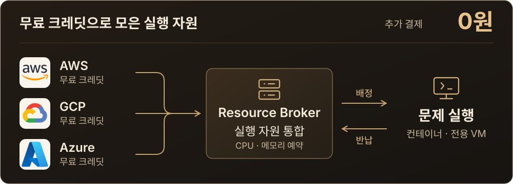

<h1>MSG CTF · Resource Broker</h1>

AWS·GCP·Azure 인벤토리 · 자원 예약·반납

<a href="https://msg-ctf.github.io/platform.html">플랫폼</a> · <a href="#development">개발 문서</a>

<h2 align="center">Overview</h2>

<strong>75팀 · 150명 · 클라우드 추가 결제 0원</strong> 크레딧 적용 후 추가 결제액 기준

| 구현 | 하는 일 |
| --- | --- |
| **Multi-cloud** | AWS·GCP·Azure 계정과 VM을 공통 인벤토리로 관리 |
| **Credits** | GCP 계정별 기준 잔액에서 Billing Export의 프로모션 사용액을 빼 잔여 크레딧 추정 |
| **Reservations** | CPU·메모리·디스크·아키텍처 조건에 맞는 실행 후보 제공과 자원 예약 |
| **Reuse** | 종료 후 예약 반납, 기동 CPU 부스트가 끝나면 예약량 축소 |

GCP 잔액은 Billing Export 반영 시점 기준 추정값입니다
잔액 조회와 별도로 실행 조건·남은 용량에 따라 자원을 배정합니다

[크레딧 조회 API](docs/GCP_CREDIT_ESTIMATE_API.md) · [자원 예약 API](docs/SCHEDULER_API.md) · [0원 운영 기록](https://github.com/MSG-CTF/msg-ctf.github.io/blob/main/docs/cloud-cost.md)

<h2 align="center">Contributors</h2>

<table align="center">
<tr><th align="center" colspan="6"><a href="https://github.com/MSG-CTF/resource-broker">Resource Broker</a></th><th align="center" colspan="6"><a href="https://github.com/MSG-CTF">PM</a></th></tr>
<tr>
<td align="center" valign="top" colspan="6" width="390"> <a href="https://github.com/gonas0919"><b>gonas0919</b></a> 클라우드 인벤토리·예약 관리 콘솔·노드 준비</td>
<td align="center" valign="top" colspan="6" width="390"> <a href="https://github.com/jongcoding"><b>jongcoding</b></a> 전용 VM·할당량 연동 인벤토리 수정·CPU 예약 축소</td>
</tr>
</table>

기여 기록 · 관련 PR

| 기여자 | 기여 내용 | 관련 PR |
| --- | --- | --- |
| [gonas0919](https://github.com/gonas0919) | 멀티 클라우드 인벤토리, 후보·예약 API, 관리 콘솔과 노드 준비 | [#4](https://github.com/MSG-CTF/resource-broker/pull/4) |
| [jongcoding](https://github.com/jongcoding) | 전용 VM·할당량 연동, 인벤토리 오류 수정과 기동 CPU 예약 축소 | [#5](https://github.com/MSG-CTF/resource-broker/pull/5) · [#7](https://github.com/MSG-CTF/resource-broker/pull/7) · [#13](https://github.com/MSG-CTF/resource-broker/pull/13) |

<h2 align="center">Tech Stack</h2>

 &nbsp;  &nbsp;  &nbsp;  FastAPI · PostgreSQL · React · Docker Python · SQLAlchemy · AWS · GCP · Azure

## Development

- [스케줄러 API](docs/SCHEDULER_API.md)
- [예약 검증](docs/RESERVATION_VALIDATION.md)
- [전용 VM](docs/DEDICATED_VM.md)
- [노드 준비 자동화](deploy/bootstrap/AUTOMATION.md)
- [설치·실행 안내](README.reference.md)

<a href="https://github.com/MSG-CTF/msg-ctf.github.io/blob/67e93a09ce630910f98ae56fb118ca1317af78e0/docs/tech-icons.md">아이콘 출처</a>

